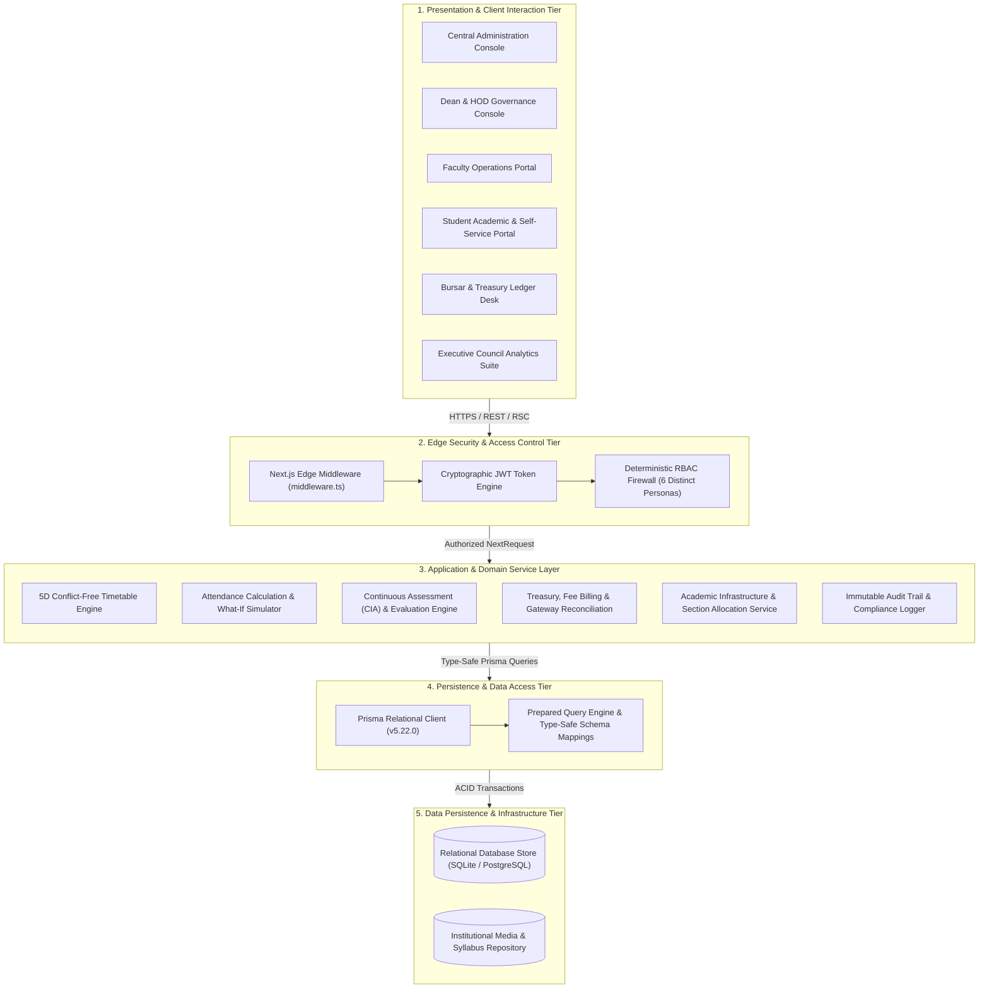
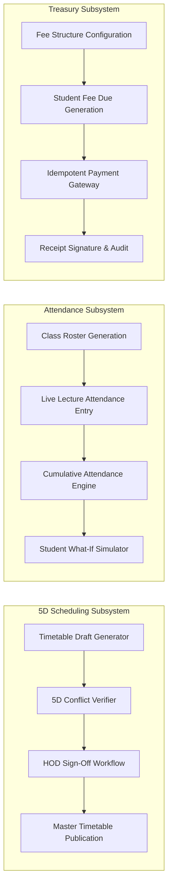
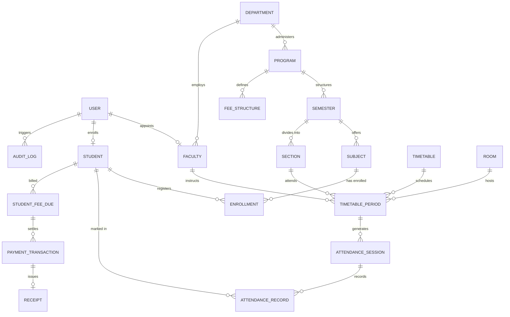
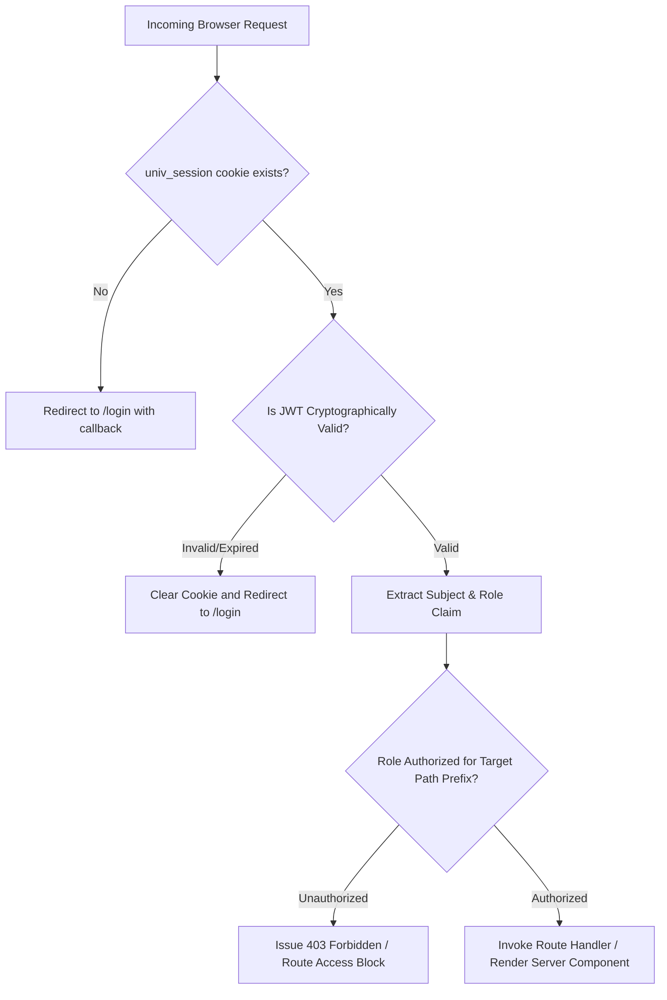

# Jagran Lakecity University (JLU) Enterprise Resource Planning Platform
## System Architecture & Technical Specification Document

**Document Identifier:** JLU-ERP-ARCH-2026-V1  
**Project:** Unified Campus Management, Digital Governance & Learning Infrastructure  
**Institution:** Jagran Lakecity University, Bhopal, Madhya Pradesh  
**Academic Year:** 2026–2027  
**Author / Engineering Lead:** Nishant Singh  
**Target Audience:** Academic Evaluation Committee, Heads of Department, Project Guides & Deans  

---

## 1. Executive Summary & Project Abstract

### 1.1 Institutional Context
Higher education institutions of multidisciplinary scale require interconnected software architectures to govern academic lifecycles, faculty teaching allocations, physical venue logistics, statutory regulatory compliance (such as UGC and NAAC), and student financial records. Disparate legacy systems often suffer from database synchronization latency, human scheduling collisions, lack of student self-service transparency, and opaque audit histories.

The **Jagran Lakecity University Enterprise Resource Planning (ERP) Platform** is an enterprise-grade, cloud-native educational management ecosystem designed and engineered to unify institutional operations under a single relational source of truth. Built using a modern full-stack TypeScript framework with Next.js 14 App Router, React Server Components, Prisma ORM, and Edge Security Middleware, the system coordinates administrative management, department-level academic planning, classroom instruction, continuous learning evaluation, treasury collection, and executive decision support.

### 1.2 Core Architectural Objectives
* **Single Source of Relational Truth:** Eliminates data silos across student admissions, course registrations, room allocations, daily attendances, and semester examination results.
* **Algorithmic Integrity (5D Conflict-Free Timetable Engine):** Mathematical guarantee that no professor, classroom, or student cohort can be scheduled into two simultaneous physical spaces at any given period.
* **Regulatory Compliance & Transparency:** Built-in continuous attendance tracking with predictive What-If simulation to ensure statutory 75% examination eligibility thresholds.
* **Edge-Enforced Role-Based Access Control (RBAC):** Zero-trust permission boundary evaluated at the edge network before server execution occurs.
* **Enterprise Light Institutional Usability:** Ergonomically designed Light Institutional Design System complying with WCAG 2.1 AAA contrast benchmarks, eliminating visual fatigue and prioritizing rapid daily administrative workflows.

---

## 2. Multi-Tier System Architecture

The JLU ERP follows a modular, five-layer layered architecture pattern ensuring high cohesion, loose coupling, and strict separation of concerns.

### Layer Deconstruction
1. **Presentation Tier:** Built on React 18 and Next.js 14 Server and Client Components. Server Components fetch database records on the server with zero client JavaScript bundle overhead; Client Components manage dynamic forms, responsive tables, interactive sliders, and modal drawers.
2. **Edge Security Tier:** A centralized Edge Middleware intercepts all HTTP requests across `/admin`, `/hod`, `/teacher`, `/student`, `/accounts`, and `/management`. JWT session cookies (`univ_session`) are cryptographically verified before any backend computation or page generation occurs.
3. **Application & Domain Service Layer:** Pure domain logic containing validation rules, collision-detection algorithms, fee ledger computations, and attendance eligibility heuristics.
4. **Persistence & Data Access Tier:** Prisma ORM provides schema migrations, declarative relational modeling, compile-time type generation, and query safety against SQL injection.
5. **Data Persistence Tier:** ACID-compliant relational storage with foreign key constraints, unique indexing, and multi-schema scaling capabilities.

---

## 3. Core Domain Subsystems & Mathematical Models

### 3.1 5D Conflict-Free Timetable Scheduling Engine
The Timetable Engine coordinates physical room infrastructure, teacher workloads, and student batches across temporal constraints.

#### Mathematical Model
Let a scheduled academic period $P$ be defined as a 5-tuple:
$$P = (f, r, s, d, t)$$
Where:
* $f \in F$: Faculty Instructor ID
* $r \in R$: Classroom / Laboratory Venue ID
* $s \in S$: Student Section / Cohort ID
* $d \in D$: Day of Week, where $D = \{\text{MON}, \text{TUE}, \text{WED}, \text{THU}, \text{FRI}, \text{SAT}\}$
* $t \in T$: Time Period Slot, where $T = \{1, 2, 3, 4, 5, 6, 7, 8\}$

#### Conflict Invariants
A timetable allocation is valid if and only if no two distinct periods $P_1$ and $P_2$ violate any of the following collision constraints:

1. **Faculty Collision Constraint:** A faculty member cannot teach two different classes at the same time:
   $$\forall P_1, P_2 \ (P_1 \neq P_2) \implies \neg (f_1 = f_2 \land d_1 = d_2 \land t_1 = t_2)$$
2. **Room Collision Constraint:** A physical venue cannot host two different classes simultaneously:
   $$\forall P_1, P_2 \ (P_1 \neq P_2) \implies \neg (r_1 = r_2 \land d_1 = d_2 \land t_1 = t_2)$$
3. **Section Cohort Constraint:** A student section cannot attend two different subjects at the same time:
   $$\forall P_1, P_2 \ (P_1 \neq P_2) \implies \neg (s_1 = s_2 \land d_1 = d_2 \land t_1 = t_2)$$

#### Approval State Machine
Timetables operate under a finite state lifecycle:
$$\text{DRAFT} \xrightarrow{\text{Verification}} \text{SUBMITTED} \xrightarrow{\text{HOD Review}} \text{APPROVED} \xrightarrow{\text{Registrar Action}} \text{PUBLISHED}$$

### 3.2 Continuous Attendance & Predictive What-If Analytics Engine

#### Regulatory Formula
Under statutory university ordinances, students must maintain a minimum attendance threshold $\theta = 75\%$ to sit for end-semester university examinations.

Given:
* $A_c$: Total lectures attended by the student in subject $S$
* $T_c$: Total lectures conducted by faculty in subject $S$
* The student's current percentage $\alpha$ is:
$$\alpha = \left( \frac{A_c}{T_c} \right) \times 100$$

#### Predictive What-If Simulation Algorithm
To empower students to take proactive corrective action before debarment notices are issued, the ERP implements a client-side simulation engine. 

Given $N$ upcoming scheduled lectures:
* If the student attends $k$ out of the next $N$ lectures ($0 \le k \le N$), their projected attendance $\alpha_{\text{projected}}$ is modeled by:
$$\alpha_{\text{projected}}(k, N) = \left( \frac{A_c + k}{T_c + N} \right) \times 100$$

The system solves for the minimum future lectures $k_{\min}$ the student must attend consecutively to restore eligibility:
$$k_{\min} = \max\left(0, \left\lceil \frac{0.75 \cdot (T_c + N) - A_c}{1 - 0.75} \right\rceil\right) = \max\left(0, \lceil 3 \cdot T_c + 3 \cdot N - 4 \cdot A_c \rceil\right)$$

### 3.3 Treasury, Billing & Gateway Reconciliation Subsystem
The financial ledger maintains institutional double-entry integrity across tuition fees, laboratory fees, examination fees, and library dues.
* **Atomic Billing:** Automatically binds student admission cohorts to program fee structures.
* **Idempotency Protection:** Payment intents generate unique cryptographic transaction hashes (`TXN-UNIV-[TIMESTAMP]-[NONCE]`). Duplicate webhooks or repeated user clicks are rejected without double charging.
* **Digital Receipt Generation:** Verified payments immediately transition dues from `PENDING` to `PAID` within an ACID transaction and issue a tamper-resistant digital receipt containing an SHA-256 verification signature.

---

## 4. Entity-Relationship & Relational Data Architecture

The underlying database consists of 22 normalized relational models enforcing referential integrity.

### Key Relational Entities

| Entity Model | Primary Key | Key Foreign Keys | Purpose & Invariants |
| :--- | :--- | :--- | :--- |
| `User` | `id (UUID)` | — | Unified identity store with bcrypt password hashing and assigned RBAC role. |
| `Department` | `id (UUID)` | `hodFacultyId` | Academic administrative unit (e.g., Computer Science & Engineering). |
| `Program` | `id (UUID)` | `departmentId` | Degree syllabus pathway (e.g., B.Tech CSE, MBA, BCA). |
| `Semester` | `id (UUID)` | `programId`, `academicYearId` | Active academic term containing mapped courses and sections. |
| `Subject` | `id (UUID)` | `departmentId`, `semesterId` | Course curriculum entity carrying credits, course type, and syllabus. |
| `Section` | `id (UUID)` | `semesterId` | Student batch cohort with maximum classroom seating capacity. |
| `Room` | `id (UUID)` | — | Physical venue, building identifier, and venue category (Classroom/Lab). |
| `Faculty` | `id (UUID)` | `userId`, `departmentId` | Academic appointment record with employee code and designation. |
| `Student` | `id (UUID)` | `userId`, `programId`, `sectionId` | Student profile with roll number, registration ID, and term status. |
| `TimetablePeriod` | `id (UUID)` | `timetableId`, `subjectId`, `facultyId`, `roomId`, `sectionId` | The atomic 5D schedule unit indexed by day and slot. |
| `AttendanceSession`| `id (UUID)` | `timetablePeriodId`, `facultyId` | Lecture attendance log finalized by the classroom instructor. |
| `FeeStructure` | `id (UUID)` | `programId`, `semesterId` | Itemized semester fee schedule (tuition, laboratory, examination). |
| `PaymentTransaction`| `id (UUID)`| `studentId`, `studentFeeDueId` | Server-reconciled financial transaction record. |
| `AuditLog` | `id (UUID)` | `actorId` | Immutable administrative trail capturing changes with actor attribution. |

---

## 5. Security Architecture & Role-Based Access Control (RBAC)

The security perimeter operates under the Principle of Least Privilege (PoLP). Access decisions are evaluated at the Next.js Edge Middleware layer via cryptographically verified session cookies.

### RBAC Permission Matrix

| Operational Capability | Administrator | HOD / Dean | Faculty / Teacher | Student | Accounts Officer | Executive Board |
| :--- | :---: | :---: | :---: | :---: | :---: | :---: |
| Academic Master Data (Depts, Rooms) | **Read / Write** | Read Only | Read Only | Read Only | Read Only | Read Only |
| Faculty Workload Allocation | **Read / Write** | **Read / Write** | Read Only | No Access | No Access | Read Only |
| 5D Timetable Generation | **Read / Write** | **Read / Write** | Read (Assigned) | Read (Cohort) | No Access | Read Only |
| Final Timetable Approval Sign-Off | Re-open / Audit | **Approve / Sign**| No Access | No Access | No Access | Read Only |
| Live Lecture Attendance Marking | Override / Audit | Department View | **Mark / Submit** | No Access | No Access | Read Only |
| Attendance Register & What-If Calc | Audit All | Department View | Class View | **Personal View**| No Access | Macro Analytics |
| Fee Structure Master Catalog | **Read / Write** | No Access | No Access | No Access | **Read / Write** | Read Only |
| Payment Gateway Reconciliation | Audit All | No Access | No Access | No Access | **Reconcile / Sign**| Macro Revenue |
| Student Fee Self-Service & Invoices | View Invoices | No Access | No Access | **Pay / View** | Manage Dues | Summary View |
| Immutable System Audit Log Ledger | **Full Ledger** | Dept Audits | Personal Logs | Personal Logs | Financial Audits | Executive Ledger |

---

## 6. Light Institutional Design System Specification

In enterprise administrative systems, UI ergonomics directly impact operational error rates and user cognitive load. The JLU ERP adheres to a **Light Institutional Design System** engineered for institutional credibility, typographic clarity, and prolonged screen comfort.

### Design Tokens & Color Strategy
* **Off-White Canvas (`#F5F6F8`)**: Reduces visual glare compared to pure `#FFFFFF` backdrops while maintaining a clean, modern aesthetic.
* **Elevated White Cards (`#FFFFFF` with `#E5E7EB` borders)**: Provides crisp physical grouping of operational widgets without resorting to heavy shadows or aggressive gradients.
* **Institutional Deep Navy (`#172B4D`)**: Primary typographic color achieving a 12.8:1 contrast ratio against card backgrounds, surpassing WCAG 2.1 AAA accessibility requirements.
* **Jagran Lakecity Burgundy (`#8B1E3F` / `#701831`)**: The university's official brand heraldic color, applied selectively to active navigation states, primary call-to-action buttons, and critical institutional focal points.
* **Semantic Indicator Palette**:
  * **Success:** Forest Emerald (`#16845B`, Bg: `#ECFDF3`) — Attendance eligibility, settled fees.
  * **Warning:** Ochre Amber (`#B7791F`, Bg: `#FFFAEB`) — Pending HOD approvals, setup requirements.
  * **Danger:** Crimson Red (`#C2414B`, Bg: `#FEF2F2`) — Timetable clashes, attendance debarment warnings.
  * **Information:** Cobalt Blue (`#3574B9`, Bg: `#EFF6FF`) — Academic year badges, timetable updates.

---

## 7. Non-Functional Requirements & Performance Benchmarks

### 7.1 Performance & Rendering Efficiency
* **Server-Driven Rendering:** Utilizing Next.js 14 App Router, dynamic pages execute SQL queries directly on the server, eliminating client-side data waterfall requests.
* **Zero Client-Bundle Bloat:** Core operational pages serve minimal client JavaScript (shared JS framework bundle $\approx 87.4\text{ kB}$), enabling instant loading on mobile devices and campus Wi-Fi networks.
* **Optimized Compilation:** Production build compiles 81 distinct dynamic routes and API endpoints in under 40 seconds with zero TypeScript or ESLint errors.

### 7.2 Scalability & Database Agnosticism
* **Prisma ORM Abstraction:** The data access layer uses standard relational SQL syntax. While configured with SQLite for local development and rapid evaluation, the schema is 100% compatible with production PostgreSQL, MySQL, or enterprise cloud database clusters (e.g., Supabase, AWS RDS, CockroachDB) by changing a single provider string in `prisma/schema.prisma`.
* **Stateless Application Tier:** User sessions rely on self-contained cryptographic tokens rather than server-side state tables, allowing horizontal container autoscaling across multiple serverless compute instances.

### 7.3 Data Integrity & Audit Compliance
* **Foreign Key Cascade Policies:** Relational integrity guarantees that orphaned records cannot exist (e.g., deleting a semester removes associated subject enrollments, while student user deletions preserve historical audit log rows with `SetNull` attribution).
* **Immutable Audit Trail:** All administrative operations (such as publishing a schedule, reconciling a payment, or overriding attendance) write an append-only row to the `AuditLog` table capturing the actor's ID, role, client IP address, action name, and JSON-encoded state change.

---

## 8. Technology Stack Specification

| Subsystem | Technology Component | Version | Engineering Justification |
| :--- | :--- | :--- | :--- |
| **Frontend Framework** | Next.js App Router | 14.2.18 | Hybrid Server/Client Components, Edge Routing, Streaming SSR. |
| **UI Library** | React | 18.3.1 | Declarative component model, Concurrent React, Suspense boundaries. |
| **Language & Typings** | TypeScript | 5.6.3 | End-to-end static type safety from database models to UI components. |
| **Styling & Design System** | Tailwind CSS | 3.4.15 | Zero-runtime CSS generation, customizable token architecture. |
| **Data Access & ORM** | Prisma ORM | 5.22.0 | Declarative relational schema, automatic migrations, type generation. |
| **Session Security** | Jose / JWT + BcryptJS | 9.0.2 / 2.4.3 | Edge-compatible stateless authentication and password hashing. |
| **Iconography** | Lucide React | 0.454.0 | Clean, accessible, standardized line icon set. |
| **Data Visualizations** | Recharts | 2.13.3 | Institutional census bar charts, treasury realization donuts. |
| **Deployment Engine** | Vercel Edge / Node.js | v20 LTS | Serverless edge distribution, automated CI/CD deployments. |

---

## 9. Academic Defense & Viva Presentation Guide

When presenting this architecture to evaluating faculty, academic deans, or external examiners, emphasize the following engineering highlights:

1. **Not a Generic SaaS Clone:** Explain that this system was designed specifically around university operational hierarchies (Vice Chancellor $\rightarrow$ Registrar $\rightarrow$ HOD $\rightarrow$ Faculty $\rightarrow$ Student Cohort) with realistic constraints like room seating capacities and teaching load limits.
2. **Demonstrate the 5D Collision Engine:** Show how the system mathematically prevents room double-booking and faculty timetable clashes through composite relational indexes (`[facultyId, dayOfWeek, periodNumber]` and `[roomId, dayOfWeek, periodNumber]`).
3. **Highlight Student Self-Service Transparency:** Demonstrate the What-If Attendance Calculator. Explain how it moves beyond passive attendance recording by giving students predictive agency to protect their examination eligibility.
4. **Showcase Enterprise Security at the Edge:** Explain how `middleware.ts` rejects unauthorized requests at the edge before backend database queries or server rendering occurs.
5. **Discuss Design System Rationale:** Explain that the light institutional theme with Burgundy accents was purposefully chosen over generic dark SaaS themes to reflect the dignity and credibility of an academic university portal.

---

*Verified and ready for presentation to the Jagran Lakecity University Academic Evaluation Committee.*
